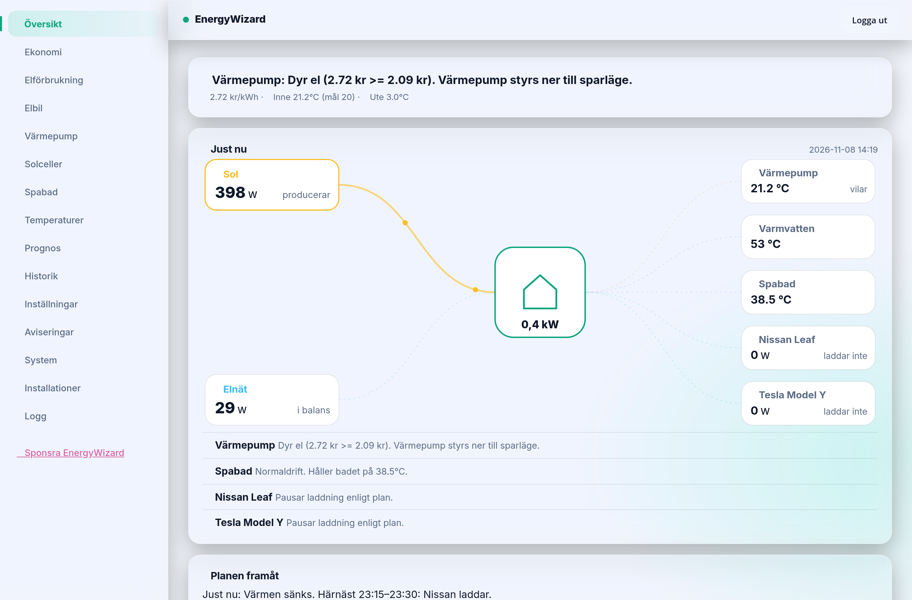

# EnergyWizard Open

**🇸🇪 [Svenska](README.md) · 🇬🇧 English**

[](https://github.com/sponsors/murre87)
[](https://github.com/murre87/energywizard/actions/workflows/tester.yml)
[](https://murre87.github.io/energywizard/en/)
[](TRANSLATING.md)

**An open control system that makes minute-by-minute decisions for the whole house based on
the electricity price** - not a point solution for a single thing. EV charging, heat pump, solar
export, home battery, spa and the main fuse are coordinated together, built on top of
[Home Assistant](https://www.home-assistant.io/) so it talks to hardware that already works there
instead of inventing new protocol code. Open source, free, no subscription.



- 🚗 **EV** - charges to your chosen time/level in the cheapest hours.
- 🌡️ **Heat pump** - lowers the heat automatically when power is expensive, "charges" the house's
  own thermal mass when it is cheap.
- 🔋 **Home battery** - a daily plan, quarter by quarter: when to charge, save and discharge.
- ☀️ **Solar export** - turns export off automatically at negative prices, back on above 0.
- 🛁 **Spa** - heats during the cheap hours.
- ⚡ **Fuse guard** - watches the main fuse so you avoid overloads.
- 📱 **Own app** (`ewapp`, mobile/PWA) and a **desktop/tablet view** (`webdashboard`) with full control,
  not just read-outs. Swedish and English.

See the [EnergyWizard site](https://murre87.github.io/energywizard/en/) for real savings figures (measured
against what the same power would have cost at the day's average price, not a guessed percentage) and a
knowledge base about how the control works.

## Local learning, not a black box

The core is a deterministic priority engine (`smartbox/gpm.py`), not a guessing AI - but it is helped by
simple machine learning trained locally on **your own house's** history (`smartbox/learning.py`): how fast
the house and the spa heat up and cool down depending on outdoor temperature and sunshine. The models are
retrained automatically and used by `smartbox/mpc.py` to predict how much heating is actually needed before
power gets expensive. The battery plan learns the battery's real efficiency, capacity and power the same way.
No data is shared between installations.

## Run as a Home Assistant add-on (Supervisor/HAOS)

[](https://my.home-assistant.io/redirect/supervisor_add_addon_repository/?repository_url=https%3A%2F%2Fgithub.com%2Fmurre87%2Fenergywizard)

Includes everything: the engine, the web dashboard (port 8503, with the entity picker) and the mobile app
(port 8502), plus its own database. Just set a `dashboard_password` in the add-on options. See
[ha-addon/smartbox/DOCS.md](ha-addon/smartbox/DOCS.md) for what is verified and what is not.

## Getting started (Docker, one line)

Running Home Assistant OS? Use the add-on above instead.

Otherwise, on any computer with Docker (a Raspberry Pi, NUC or NAS):

```bash
curl -fsSL https://raw.githubusercontent.com/murre87/energywizard/main/install.sh | bash
```

Then open `http://your-computer:8503`. The setup wizard does the rest (pick **English** on the first screen):

1. **Choose a password.**
2. **Connect Home Assistant.** Enter the address and paste a token. The wizard tests the connection before saving.
3. **Pick your devices.** The entity picker finds them in Home Assistant. Tick what you have and press **Save and start**.

No file needs editing. Everything is stored in `~/energywizard/data`, and EnergyWizard updates itself.

Prefer doing it yourself? `docker-compose.enkel.yml` is enough - save it as `docker-compose.yml` and run
`docker compose up -d`. Or without compose:

```bash
docker run -d --name energywizard --restart unless-stopped -p 8503:8503 -p 8502:8502 -v energywizard:/data ghcr.io/murre87/energywizard:latest
```

## Supported hardware

Everything goes through the device's own Home Assistant integration or a local API, never our own protocol
code against unknown registers. ✅ = running in real homes. The rest is built against the integrations' source
code and waits for a beta tester with real hardware.

| Area | Supported |
|---|---|
| 🌡️ **Heat pump** | ✅ Thermia via Husdata · ✅ anything with a `climate` entity in HA · NIBE S series (local API) · NIBE/Bosch/Atlantic/Daikin via myUplink · Panasonic Aquarea via HeishaMon |
| 🔋 **Home battery** | controls: Solax Gen4-6 and Growatt (Solax Modbus), FoxESS (local and cloud) · reads: Felicity, SolarEdge, GivEnergy, Huawei Luna, Sonnen, Victron and others. Five planning styles and a choice whether the battery may sell to the grid. |
| ☀️ **Solar** | ✅ SolarEdge · Huawei SUN2000 · Growatt · Sungrow · Fronius · generic export limit (Solis, Solplanet, Sigenergy and others) |
| 🚗 **EV** | ✅ Tesla · ✅ Nissan · generic (any HA entity) |
| 🔌 **Charger** | ✅ Easee · OCPP (e.g. Charge Amps, cFos, FoxESS) · generic (`switch`/`number`) |
| 🛁 **Spa** | ✅ Gecko · Balboa · Shelly relay |

How the battery behaves depending on your choices, with pictures:
[Do you have a home battery?](https://murre87.github.io/energywizard/en/kunskapsbank/home-battery.html) ·
heat pumps: [Controlling a heat pump by price](https://murre87.github.io/energywizard/en/kunskapsbank/controlling-a-heat-pump-by-price.html).

Missing your brand? The generic drivers (`generic_*`) already cover most cases as long as the device works in
Home Assistant. For brand-specific control, see `smartbox/drivers/*.py` for the interfaces - contributions welcome.

## Telemetry (on by default, easy to turn off)

Sends only: a hashed house identifier (`sha256(house_id)`), which driver categories are active (e.g.
`solar:solaredge` - no entity ids or sensor values) and the brand from Home Assistant's device registry
(e.g. `battery:generic@FoxESS`), once a day, error types from critical errors in the main loop (the
exception class name, never the message), a version hash and a timestamp. Nothing else - no price data, no sensor
history, no location. See `smartbox/telemetry.py` for exactly what is sent. To send nothing at all, set
`TELEMETRY_OPT_IN=false` in your `.env`.

## 🌍 Translate

The web and the mobile app are available in Swedish and English. The language is chosen in the setup wizard and
can be changed under Settings. Anyone can fix a text or add a new language directly on GitHub, without
programming: see [TRANSLATING.md](TRANSLATING.md).

## ❤️ Support the project

EnergyWizard is free, without subscription or ads, and will stay that way. The most expensive part is not the
code but **verifying against real hardware**.

<p>
  <a href="https://github.com/sponsors/murre87"></a>
</p>

- ⭐ **Star the repo** - it makes the project easier to find.
- 🙋 **Become a beta tester** - [open a "Beta tester: my house" issue](https://github.com/murre87/energywizard/issues) and tell us what you have.
- 🐛 **Report bugs** with the log - [open an issue](https://github.com/murre87/energywizard/issues).

## Structure

- `smartbox/` – the control engine (main loop, drivers, priority engine).
- `webdashboard/` – desktop/tablet dashboard. `ewapp/` – the mobile app (PWA).
- `docs/` – the public site (GitHub Pages), in Swedish and English.
- Images are built by GitHub (`.github/workflows/docker.yml`) to `ghcr.io/murre87/energywizard-*`.
